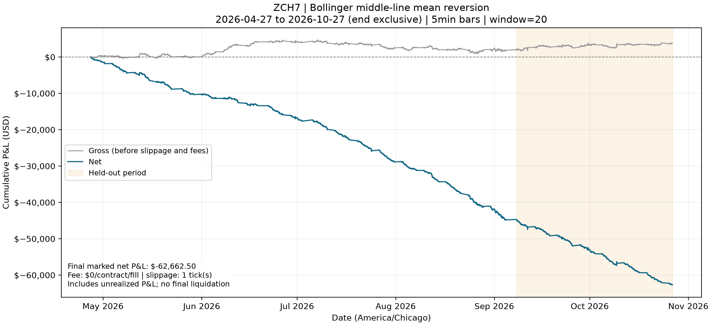

# Corn Futures: a cost-aware intraday mean-reversion study (CBOT ZC)

**We built an end-to-end research pipeline for CBOT corn futures (ZC) — from
raw Databento trades to a transaction-cost-aware backtest — and used it to test
a simple intraday mean-reversion rule. The headline finding is a clean negative
result: on six months of March-2027 corn (ZCH7), the rule loses money steadily,
and the loss is driven almost entirely by trading costs rather than by a wrong
directional view.**



## Headline result

Running a Bollinger middle-line mean-reversion rule on 5-minute ZCH7 bars
(20-bar window) over **2026-04-26 to 2026-10-26**, with one tick of slippage per
fill and no commissions, produces a **cumulative net P&L of −$62,462.50** on a
single-contract strategy. The equity curve declines almost monotonically — there
is no regime in which the rule works and then breaks.

The interpretation matters more than the number. The rule reverses position
whenever price crosses its 20-bar average, so it trades constantly; at a 5-minute
horizon, corn's price changes look close to a random walk, so each reversal pays
the quarter-cent tick ($12.50/contract) without a reliable edge to cover it. The
loss is a **microstructure-cost result, not a forecasting result**: a naive
mean-reversion signal on liquid intraday corn does not survive even minimal,
realistic execution costs. That is a useful conclusion for the team's broader
question of whether tradable intraday patterns exist in this market.

## What the project does

The repository is a small, tested Python package (`finm37000`) implementing a
reproducible pipeline, each stage reusable on its own:

1. **Data** (`data_store`, `pull_data`) — download ZCH7 trade-level data once
   from **Databento** (CME Globex, `GLBX.MDP3`), validate it, and cache it
   locally; raw data is git-ignored.
2. **Bars** (`bars.build_analysis_bars`) — aggregate trades into completed,
   event-time 5-minute bars labeled at the bar **end**, with OHLCV and
   order-flow imbalance computed over the same intervals and incomplete
   trailing bars excluded.
3. **Features** (`features`) — moving averages, Bollinger bands, horizon
   returns, rolling realized volatility, and order-flow imbalance, each
   computed using only information available at the bar close.
4. **Prediction dataset** (`dataset`) — assemble causal features with an
   explicit future-return target, then split chronologically with a **purge**
   that removes training rows whose target window reaches into the test period.
5. **Baseline predictor** (`baseline`) — a standardized (optionally ridge)
   linear regression fit on training rows only and scored **once** on the
   held-out period against a zero-return benchmark, reporting out-of-sample R²
   and a tick-aware directional hit rate. On a random-walk control it correctly
   shows no edge, confirming the evaluation is honest rather than optimistic.
6. **Backtest** (`backtest/`) — an event-driven engine that executes each signal
   at the **next** bar's open (a one-bar delay, so no look-ahead), applies
   configurable per-tick slippage and per-contract fees, and tracks realized and
   unrealized dollar P&L using the correct ZC contract spec (5,000 bushels,
   cents/bushel, ¼-cent = $12.50 tick). This is what produces the result above.

We also assessed a **USDA report-surprise** overlay (`usda`,
`docs/usda_feasibility.md`): the actual figures and precise release times are
obtainable (NASS QuickStats; reports at noon ET), but historical *pre-report
market expectations* have no free, programmatic source, so we documented that
component as a feasibility finding and deferred it rather than fabricate data.

Correctness is enforced throughout: every stage validates its inputs and rejects
look-ahead, and the package ships a full test suite (`pytest`) that runs on
synthetic data with no market-data access required.

## Repository layout

- `src/finm37000/` — the package (data, bars, features, dataset, baseline,
  `backtest/`, usda, plus the course helpers).
- `examples/` — runnable scripts for each stage, including the headline backtest.
- `outputs/` — generated figures (e.g. `ZCH7_net_pnl.png`).
- `docs/usda_feasibility.md` — the USDA data-source assessment.
- `DEVELOPER_NOTES.md` — original project plan and engine-internals notes.

---

## How to run it

Requires **Python 3.12+**. From the repository root:

```bash
python3 -m venv .venv
source .venv/bin/activate          # Windows PowerShell: .venv\Scripts\Activate.ps1
python -m pip install -e .
python -m pip install pytest
python -m pytest                   # full test suite, synthetic, no API key needed
```

### Reproduce the headline backtest (uses Databento CME data)

Put a Databento API key in `~/.databento_api_key` (the download consumes
credits; the script prints an estimate first), then:

```bash
# Download the latest ~6 months of ZCH7 trades and backtest them:
python examples/run_historical_corn_backtest.py --download
```

This saves the net-P&L chart to `outputs/ZCH7_net_pnl.png`. If you have already
cached data, pass the actual exclusive coverage endpoint instead of downloading:

```bash
python examples/run_historical_corn_backtest.py --end 2026-10-26T00:00:00-05:00
```

Tune the run with `--window`, `--bar-rule`, `--slippage-ticks`, and
`--fee-per-contract`.

### Explore the pipeline without a key (synthetic)

```bash
python examples/run_corn_backtest.py        # synthetic backtest demo
python examples/analysis_bars.py            # event-time bars + prediction dataset
python examples/baseline_predictor.py --synthetic   # predictor shows no edge on a random walk
python examples/usda_feasibility.py         # USDA surprise -> price-reaction join
```

## Future work

Natural extensions: test entry-at-the-band / exit-at-the-middle variants and
longer horizons where costs bite less; add order-flow-imbalance features to the
predictor; and, if a historical expectations series can be sourced, complete the
USDA surprise regression. See `DEVELOPER_NOTES.md` for the original plan.
